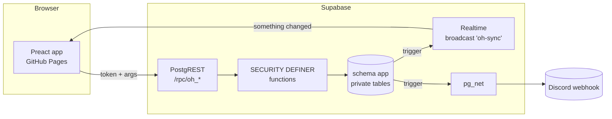

# 叁式 ULTRACOMBOS One Hour a Week

TN0006 的 Office Hour 預約平台。

**每組每週和叁式 PM 一小時。**
TN0006「一場體驗如何發生：跨域數位製作實務」的 Office Hour 預約平台。每組有固定的業師和時段，每週六 20:00 前決定下週要不要約，送出就排定，全組、老師、助教的畫面即時同步。

- 正式網站：<https://tndaixd2026-dot.github.io/tnda-office-hour/>
- 示範模式（不需代碼，三種角色都能試）：<https://tndaixd2026-dot.github.io/tnda-office-hour/#/demo>。首頁的「試玩預約流程」只開學生身份，旁邊列出學生怎麼預約
- TD 專班課表（週三 VSAI 的助教課，公開、不用登入）：<https://tndaixd2026-dot.github.io/tnda-office-hour/#/td>


---

## 三種角色

| | 學生 | 助教 | 老師（叁式 PM） |
|---|---|---|---|
| 怎麼進來 | 首頁輸入名字（要先在學生名單上），或點小組的邀請連結 | 首頁輸入名字，或助教登入連結 | 首頁輸入自己的名字，或共用帳號「叁式」，或專屬連結 |
| 看得到 | 自己這組的固定時段、每週的預約、排定的時間和討論室 | 全部 | 三位老師這週和下週的全部場次、各組的題目、想問的問題與進度（自己的會標出來） |
| 能做什麼 | 預約這週或這週不約（題目、想問的問題、進度、雲端連結）、截止後取消、訂閱行事曆 | 設定各組固定時段和業師討論室、代班／改期／取消、管理小組／老師／時段／週次／規則、寄信通知、匯出 | 訂閱行事曆（其他事助教處理） |

**老師看同一個畫面。** 三位老師和共用帳號「叁式」（給業師公司或老師助理用）登入後看到的是同一個畫面：這週和下週的一覽表（日期 × 老師），可以只看某一位，每一場的題目、進度和資料都在下面。訂閱一次行事曆之後，連網站都不用開：新的場次、異動、取消會自動出現在 Google 日曆／Apple 行事曆裡。共用帳號的行事曆包含三位老師的全部場次，不會被排進任何場次。

**每週在各組的 Discord 頻道詢問和提醒。** 週五 08:00 機器人在每組頻道貼出下週的固定時段，組員直接在 Discord 按「預約這週」（跳出表單填題目、想問的問題、進度和雲端連結，送出就排定）或「這週不約」，不用打開網站。週六 20:00 截止後，訊息會改成結果；週日 08:00 告訴每組下週的結果（有沒有約都會發），場次當天 08:00 再提醒一次。

**每週一 08:00 自動寄信。** 收件人在後台「寄信通知」設定，每個人可以勾選要收哪幾位老師的場次。信裡每一場都有「加到 Google 日曆」按鈕和業師的討論室，最上面還有一鍵訂閱全部場次的按鈕。助教信箱會先在週日 18:00 收到預覽。

## 一學期的用法（助教）

1. 在首頁輸入自己的名字登入（或用助教登入連結）。新的助教在「設定」→「助教帳號」新增，輸入全名即可。
2. **小組與邀請**：在每組的「學生名單」填上同學的名字（一行一個），同學到首頁輸入自己的名字就能登入。也可以把每組的邀請連結貼到該組 Discord，或在課堂上「投影邀請 QR」讓同學掃描。每組卡片上的「固定時段」設定這組的業師、星期和時間（每次一小時），隨時可改；沒有固定時段的組不能預約。
3. **老師**：老師到首頁輸入自己的名字就能登入（名字要和「老師」頁上的一樣），也可以把專屬連結私訊給他們。每位老師的選單裡可以「設定討論室」（各自的 Google Meet 連結），學生畫面、行事曆和每週的信都用它；代班時用代班老師的討論室。
4. **時段與週次**：確認老師的開放時段、國定假日、哪幾週開放預約。
5. **寄信通知**：新增收件人（三位老師、公司信箱、老師助理…），勾選每個人要收哪幾位老師的場次，填上助教信箱。第一次使用前要先完成 Gmail 設定（見下方「每週寄信」）。
6. 每週的節奏：
   - **截止前** 各組按「預約這週」（題目、想問的問題、進度、雲端連結都要填）就直接排進固定時段，或按「這週不約」。之後的每一週都可以先約好，每週只看自己的截止時間（前一週的週六 20:00）。**排程** 頁列出每組的狀態，還沒回覆的組可以一鍵複製提醒訊息。
   - **週五 08:00** 機器人在每組的 Discord 頻道問下週要不要約（見下方「Discord 每週詢問」），組員可以直接在 Discord 預約或不約。
   - **週六 20:00** 下一週的預約截止，學生之後不能再修改或改成不約；Discord 的訊息改成結果。已排定的場次在開始前 24 小時都可以自己取消。
   - **週日 08:00** 機器人告訴每組下週的結果：時間、業師、討論室和題目，或這週不排的原因（不約、沒有回覆、放假）。
   - **場次當天 08:00** 機器人提醒那一組今天的時間和討論室。
   - **業師臨時有事**：在 **排程** 頁那一場按「代班」（換一位業師，時間不變）、「改期」（列出這位業師的空檔，沒有固定組的時段標成備案）或「取消」（寫原因給這組）。學生和業師的畫面會立刻更新；有連結 Discord 的組別會自動收到通知。
   - **週日 18:00** 助教信箱收到預覽，確認週一要寄出的內容。
   - **週一 08:00** 每位收件人收到這週的場次。
7. 想讓通知自動進 Discord：在小組卡片按「連結頻道」，貼上該頻道的 Webhook 網址。

規則（預約截止的星期和時間、可取消時間、公告）都在 **設定** 裡調整，改動立即生效。

## TD 專班課表

週三 VSAI 課程的 TD 專班（助教上的基礎教學、案例分享、駐村創作）也放在這個平台，網址是 `#/td`。

- **公開、不用登入。** 學生打開網址就看得到「下一堂」，可以切換五種檢視：清單（依週分組，已結束的週收起來）、週曆（時間表，手機上是每天一張清單）、月曆、依講師（每位講師一欄，附各類型堂數）、依單元（每個單元的主題、說明和上課時段）。可以只看某位講師或某種類型；只看某位講師時網址會變成 `#/td/講師名字`，可以直接分享。點任何一堂會看到完整內容和「加到 Google 日曆」。
- **類型比例。** 後台「類型比例」設定基礎教學、案例分享、駐村創作的比例（各 0–20），還沒上的課會照比例調整類型：改動的堂數最少、平均分散在各週，沒分單元的課優先改（改了類型的課會離開原本的單元）。已經開始或上完的課，以及在課程裡勾了「已確定」的課不會變動，但會算進比例裡。套用前會先列出會改哪幾堂。
- **顏色。** 每種類型一個顏色（基礎教學 #FCD0A1、案例分享 #53917E、駐村創作 #6D1A36，用方塊、色條和實心的類型標籤標示，標籤上的字會自動配黑或白），每位講師一個顏色（圓點）。後台和公開頁用同一套，名字和類型也都會寫出來，不是只靠顏色。
- **訂閱行事曆。** 可以訂閱全部，或只訂閱某位講師的課（`oh_lessons_calendar` 的 `p_teacher`），加課、改時間、補上標題都會自動更新。
- **單元。** 每種類型可以再分成單元，例如基礎教學（一）、（二），一開始每種類型先列好（一）到（十），主題可以先空著（顯示「主題待定」，公開頁要等有主題或有排課才會出現），不夠用就新增，用不到的刪除。助教在後台「單元」寫主題和說明，再勾選哪幾堂上這個單元（一堂課只屬於一個單元，勾到別的單元的課會移過去）；可以改編號，其他單元會自動往前或往後移。公開頁的課名會變成「基礎教學（一）主題」，有「依單元」的檢視和單元篩選，點開一堂會看到單元說明和這個單元的所有時段，行事曆的標題也會寫上單元。
- **助教在後台「TD 課表」維護。** 新增、修改、刪除每一堂，改頁面標題、上課地點和公告；所有人的畫面即時更新。同一時間只能排一堂課（不管是哪位講師），撞時段時會直接說和哪一堂重疊。
- **匯入與匯出。** 格式和原本獨立課表網站的 `schedule.json` 一樣，另外多了 `units`（`{type, no, title, topic}`）和每堂的 `unit`（同類型單元的編號）。新學期可以把整份課表做成 JSON 一次匯入（會取代全部的課；檔案有 `units` 時單元也一起換掉，沒有時保留現有的單元）。
- 這份課表是公開的，所以不要放薪資、時數、助教不能上課的日期等內部資料。

## 設計

- **紙、墨、一個訊號色。** 版面只靠字級與留白建立層次；橘色只出現在「你選的」和「正在發生的」東西上。
- **一個畫面一件事。** 學生首頁先回答「下一次是什麼時候」，再談預約；老師首頁只有行程；助教的排程板把需求、空檔、草稿放在同一張表上。
- **即時、而且說得出發生了什麼。** 組員改了需求、助教排好時間、有人取消，畫面會更新並跳出一行說明，不需要重新整理。
- **手機優先。** 學生大多用手機：格子 44px 以上、可點可拖曳、無水平捲動；助教在手機上一次看一天。
- **無障礙。** 所有文字對比 ≥ 4.5:1（WCAG AA）、完整鍵盤操作、表單錯誤與說明以 `aria-describedby` 連結、支援減少動態效果與深色模式。

## 架構



- **後端就是一組 SQL 函式。** 所有資料表都在不對外開放的 `app` schema；瀏覽器只能呼叫 `public.oh_*` 函式，每個函式先驗證身份，再套用預約規則（每週的截止時間、每週／每日上限、老師不重複、組員同時編輯的版本衝突）。規則只寫在資料庫一處，任何客戶端都繞不過。
- **即時同步。** 每次寫入都會在 `oh-sync` 頻道廣播「哪張表變了」，只有表名，不含任何資料；客戶端收到後透過 API 重新取得自己有權看的資料。斷線時還有切回分頁、恢復網路、每分鐘輪詢三層保險。
- **示範模式跑的是同一套 SQL。** 用 [PGlite](https://pglite.dev)（編譯成 WebAssembly 的 Postgres）在瀏覽器裡建立完整資料庫，執行與正式環境完全相同的 migration。引擎從 jsDelivr 下載（約 2 秒），並用建置時記錄的 SHA-256 驗證；失敗時改用網站自帶的備份。
- **行事曆訂閱也是同一套 SQL。** `oh_calendar` 直接由 PostgREST 以 `text/calendar` 回應（`"*/*"` media type handler），每位老師、每一組各有一條可作廢的私密網址，不需要另外的伺服器。TD 專班課表的 `oh_lessons_calendar` 用同一個方法，但是公開的，所有人共用一條網址。
- **固定時段，送出就排定。** 每組的業師、星期、時間存在 `app.groups`；學生按「預約這週」時 `oh_booking_save` 直接在固定時段建立已確認的場次，「這週不約」由 `oh_booking_skip` 記下並拿掉那週的場次。兩者都轉給 `app.booking_save`／`app.booking_skip`，Discord 的按鈕走的是同一套規則。之後的每一週都能先約，每週只看自己的截止時間（`app.week_bookable()`），固定時段那天放假就停一次。助教的代班、改期、取消改的是同一筆場次，學生之後修改內容也不會蓋掉。
- **Discord 每週詢問。** `scripts/discord-ask.mjs`（GitHub Actions）用機器人的 Token 發訊息，訊息內容由資料庫的 `app.discord_message` 產生；按鈕和表單送到 Supabase Edge Function `supabase/functions/discord`，它只驗證 Discord 的簽章，再交給資料庫的 `app.discord_interaction` 回應。每組的頻道從那組連結的 Webhook 查出來，不用另外設定。
- **每位業師一間討論室。** 每位老師有自己的 Google Meet 連結（`app.teachers.room`），學生、老師、行事曆和每週的信都顯示那一場業師的討論室，所以同一時段可以有好幾組。
- **閃身步排程法（舊制）。** 改成固定時段之前，學生勾選可以的時段，再用最大流排程（`src/lib/scheduler.ts`），現在畫面上已經不用了。

## 安全

- 邀請代碼由資料庫以 CSPRNG 產生（8／10／12 碼，排除易混淆字元），可隨時更換並一併登出舊裝置。
- 登入後裝置只保存一組隨機憑證（64 個十六進位字元）；資料庫只存它的 SHA-256。180 天未使用自動失效。
- 錯誤代碼和查無此人的名字都算猜測，有 IP 節流（10 分鐘 20 次）。
- **名字登入是刻意選擇的便利性取捨**：知道名字的人就能以那位學生（整組）或老師的身分登入。助教也能用名字登入，等於知道名字就有全部管理權限。名字比對不分大小寫、忽略空格；同一個名字只能出現在一個名單上，同名時會要求改用邀請連結。名為「助教」的原始帳號只能用代碼登入，留作備用。
- 資料表全部啟用 RLS 且沒有任何 policy，`anon` 角色只有 `oh_*` 函式的執行權；GraphQL 不暴露任何資料表（`npm run db:test-cloud` 會實際驗證）。
- 正式版有 Content-Security-Policy；使用者輸入一律以文字呈現，連結只接受 http(s)；CSV 匯出防公式注入；Discord 訊息關閉 @mention。
- Supabase 的帳號註冊已關閉（這個系統不使用 Supabase Auth）。

## 開發

```bash
npm install
npm run dev          # http://localhost:5173（沒有 .env.local 時只能用示範模式）
npm test             # 資料庫 API、排程演算法、Discord 通知與每週詢問、行事曆、TD 課表、寄信：154 項
npm run build && npx vite preview --port 4173
npm run e2e -- http://localhost:4173/   # 真實瀏覽器跑三種角色（示範模式）
```

本機完整雲端堆疊（需要 Docker／Colima）：

```bash
supabase start
npm run db:reset-local                 # 固定測試代碼 LOCALADMIN01、LOCALG01…
npm run e2e:cloud -- http://localhost:5173/ LOCALG02 LOCALADMIN01
```

### 資料庫變更

在 `supabase/migrations/` 新增一個檔案（不要修改已部署的檔案），用 `npm test` 確認後推到 `main`。GitHub Actions 會在所有測試通過後，自動把新的 migration 套用到正式資料庫，再部署網站。資料庫密碼存在 repo 的 Actions secret `SUPABASE_DB_PASSWORD`；其他分支和 PR 只會列出將要套用的 migration，不會真的寫入。

需要手動推送時：

```bash
supabase db push
```

### 新學期重新開始

保留課程設定（小組、老師、開放時段、週次、假日），清除所有預約、登入、學生名單與紀錄，並重新產生所有邀請代碼與行事曆連結：

```bash
psql "<資料庫連線字串>" -f scripts/fresh-start.sql
```

週次可以在「時段與週次」→「產生週次」一次建立。TD 專班課表不會被清掉，新學期在後台「TD 課表」用匯入換成新的課表。

### 每週寄信

`.github/workflows/mail.yml` 每週日 11:38、17:38 和週一 07:38（台北時間）啟動，`scripts/send-mail.mjs` 等到 12:00／18:00／08:00 整點才寄，避開 GitHub 排程延遲。信的內容由資料庫的 `app.mail_outbox` 產生，所以後台「寄信通知」的預覽就是實際寄出的內容；`app.mail_log` 記錄寄過的信，同一週不會重複寄。

第一次使用前（只要做一次）：

1. 用要寄信的 Gmail 帳號開啟兩步驟驗證，再到 <https://myaccount.google.com/apppasswords> 建立一組「應用程式密碼」。
2. GitHub repo → Settings → Secrets and variables → Actions，新增 `GMAIL_USER`（Gmail 地址）和 `GMAIL_APP_PASSWORD`（16 個字母的應用程式密碼）。
3. Actions →「Weekly email」→ Run workflow，選 `test` 只寄一封測試信給寄件的 Gmail 自己（最近一週有場次的信，三位老師都有），不會寄給任何收件人，也不影響週日和週一的正式寄送。還沒有發布場次時選 `sample`，會用示範模式的場次（配上正式的會議室連結）寄一封範例信給自己。要讓每位收件人確認收得到信時選 `sample_all`：每個人（開關關著的也算）都會收到一封標明【測試】的信，內容是他會收到的那幾位老師的示範場次，不影響正式寄送。改了某個人的信箱想單獨重寄時，在 `only` 填他的稱呼。選 `preview` 是寄預覽到助教信箱；也可以勾「只列出要寄的信」先看會寄給幾個人。

紀錄是公開的（公開 repo），所以只印主旨和數量，不印 Email。

### Discord 每週詢問

`.github/workflows/discord.yml` 每天 07:38 和週六 19:38（台北時間）啟動，`scripts/discord-ask.mjs` 等到 08:00／20:01 才動作：每天 08:00 提醒當天有場次的組；週五 08:00 另外在每組的頻道貼出下週的固定時段和按鈕；週六截止後把詢問改成結果、拿掉按鈕；週日 08:00 另外發下週的結果。每則訊息每組只發一次（`app.discord_posts`、`app.discord_notes`），重跑也不會重複。組員按「預約這週」會跳出 Discord 的表單（題目、想問的問題、進度、雲端連結，可以帶出上次填的內容），送出就排定；按「這週不約」就記下來。訊息用 Discord 的格式排版：時間是標題，截止時間加粗並附上倒數，說明是小字；學生打的題目和名字會照原樣顯示，不會變成格式。訊息上的「這週不約」記得它是什麼時候的狀態：組員在網站上改過之後，按舊訊息上的按鈕只會把訊息更新成現在的樣子，不會蓋掉。後台「Discord 詢問」可以看機器人狀態、每組頻道、訊息預覽和發送紀錄。

第一次使用前（只要做一次）：

1. 到 <https://discord.com/developers/applications> 按 New Application（名稱例如 Office Hour）。請用新的 Application，不要和其他服務共用。在 Bot 頁按 Reset Token，複製 Token。
2. 在 OAuth2 → URL Generator 勾選 `bot`，權限勾 View Channels 和 Send Messages，打開產生的網址，把機器人加進課程的伺服器。
3. 在每組的頻道（或整個分類）的權限加入這個機器人，讓它看得到、能發言。
4. GitHub repo → Settings → Secrets and variables → Actions，新增 `DISCORD_BOT_TOKEN`（剛剛的 Token）和 `SUPABASE_ACCESS_TOKEN`（Supabase → Account → Access Tokens 產生，用來部署 Edge Function）。
5. Actions →「Test and deploy」→ Run workflow（部署 Edge Function），完成後再執行「Discord weekly ask」，選 `setup`。腳本會從 Discord 讀出機器人的 Public Key 存進資料庫，把機器人的 Interactions Endpoint 設成 Edge Function（Discord 會當場驗證），再從各組的 Webhook 找出頻道。後台「Discord 詢問」顯示「已連接」就完成了。想先試一組時，選 `ask`、在 `only` 填組別編號。改了訊息的樣式，或想讓已發出的訊息反映網站上的變動時，選 `refresh`。

紀錄是公開的，所以只印組別編號、數量和 Discord 的狀態碼，不印 Token、Webhook 或訊息內容。

### 開學前檢查

1. 打開 Supabase 後台，確認專案沒有暫停。如果暫停了，按 Resume 恢復（免費）。
2. 到 GitHub repo 的 Actions，「Keep database awake」「Weekly email」「Discord weekly ask」如果顯示已停用就按 Enable。公開 repo 連續 60 天沒有 commit 時，GitHub 會自動停用排程。

### 部署

推到 `main` 後，GitHub Actions 會依序執行型別檢查、單元與資料庫測試、正式建置、真實瀏覽器端對端測試，全部通過才把新的 migration 推到 Supabase，再部署到 GitHub Pages。另有每日排程呼叫一次 API，避免 Supabase 免費方案因閒置而暫停（GitHub 會在 60 天沒有 commit 時停用排程，見「開學前檢查」）。

## 費用：全部免費

| 服務 | 用途 | 方案 |
|---|---|---|
| GitHub Pages | 網站 | 公開 repo 免費 |
| GitHub Actions | 自動測試、資料庫 migration、部署、每日喚醒 | 公開 repo 不限分鐘數 |
| Supabase | 資料庫、API、即時同步、Discord 通知、Discord 按鈕的 Edge Function | Free 方案（組織沒有綁定任何付款方式，不可能產生費用；Edge Function 每月 50 萬次） |
| jsDelivr | 示範模式的資料庫引擎 | 免費 |
| Google Fonts | Noto Sans TC、IBM Plex Mono | 免費 |
| Discord Webhook、Discord 機器人 | 自動通知、每週詢問 | 免費 |
| Gmail | 每週一寄給老師的信 | 免費（每天上限 500 封） |

Supabase 免費方案提供 500 MB 資料庫、每月 5 GB 流量、200 個同時連線。一門課約 7 組、40 人，一整學期的資料量大約只有幾 MB，連上限的百分之一都不到。免費專案閒置 7 天會暫停，所以 GitHub Actions 每天會呼叫一次 API 讓它保持運作。即使暫停，Supabase 也會在暫停前一週和暫停當下寄信給組織擁有者，暫停後至少 90 天內都能在後台免費恢復，資料都還在。

## 專案結構

```
supabase/migrations/   資料表、API 函式、Discord 通知與每週詢問、登入期限、名字登入、TD 課表
supabase/functions/    discord：Discord 按鈕和表單的 Edge Function（驗證簽章後交給資料庫）
supabase/seed.sql      課程初始資料（小組、老師、開放時段、W7–W18）
src/api/               雲端（Supabase）與示範（PGlite）兩種引擎，同一個介面
src/views/             student / teacher / admin / lessons（TD 課表公開頁）/ Welcome
src/lib/scheduler.ts   閃身步排程法（最大流）
tests/                 Vitest：資料庫規則、排程、示範資料、Discord、TD 課表
scripts/               端對端測試、雲端安全檢查、PGlite 資產準備、每週寄信、Discord 每週詢問
```

## 三分鐘展示腳本

1. **開場（20 秒）**：打開 `#/demo`。「每學期助教要和七組、三位 PM 來回喬時間，訊息散在 Discord 各處。這個平台把它變成一個畫面。」
2. **學生（60 秒）**：切到「學生」。首頁直接告訴你下一次是什麼時候、還有幾小時，下面是這組的固定時段。點可預約的週次 →「預約這週」→ 寫題目、想問的問題、進度、雲端連結 →「預約這週」，馬上排定。不約就按「這週不約」。「整組共用一份預約；兩個人同時改，系統會攔下衝突，不會互相覆蓋。」
3. **助教（60 秒）**：切到「助教」。排程頁一組一列：已預約、這週不約、還沒回覆。業師臨時有事時按「代班」「改期」（備案時段會標出來）或「取消」，學生和業師的畫面立刻更新。
4. **老師（20 秒）**：切到「老師」。「PM 不需要學任何東西：打開連結就是下一場、哪一組、要聊什麼、雲端資料夾。」
5. **收尾（20 秒）**：「示範模式跑的是一個完整的 Postgres，在你的瀏覽器裡，執行與正式環境同一份 SQL。正式環境在 Supabase，所有規則寫在資料庫裡，任何人都繞不過；每個變動即時推送到每個人的畫面，也會自動通知 Discord。」
